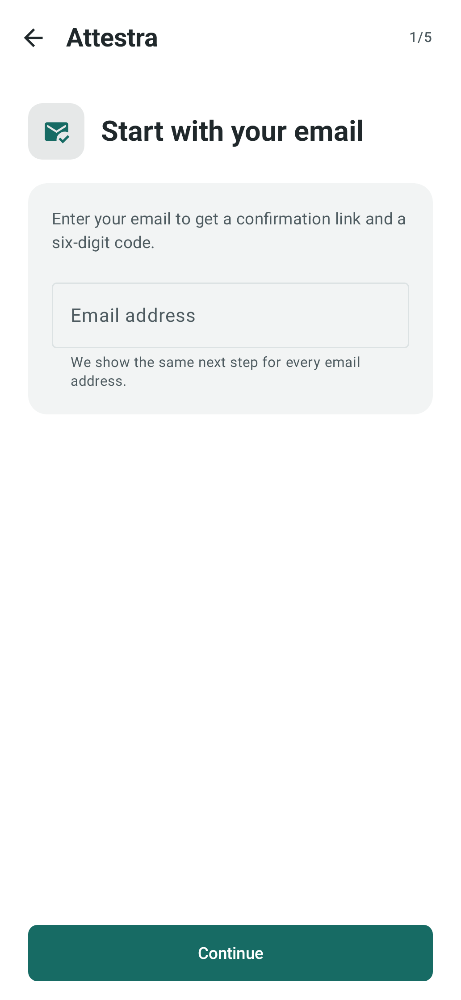
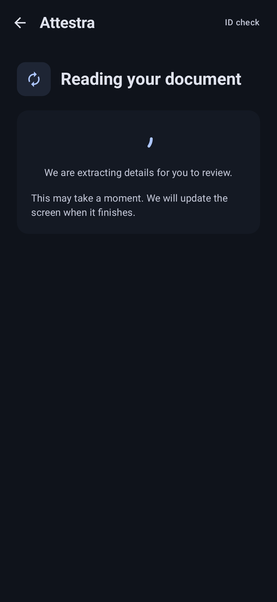
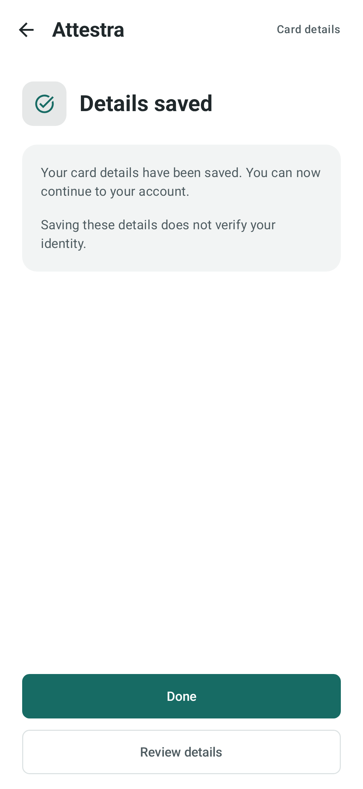

# Onboarding ID capture

Implements the capture and card-review contract in [go.attestra.aws.auth/docs/id-capture.md](https://github.com/lambdawalker/go.attestra.aws.auth/blob/main/docs/id-capture.md), following [design.attestra](https://github.com/lambdawalker/design.attestra/tree/main/auth/onboarding/id-capture). The backend extracts card fields and the app shows an editable review form. Standalone identity validation is not implemented. The previous combined verification mock is replaced.

`:auth` owns `capture/CaptureApi`, `CaptureController`, `CaptureHost` and encrypted account/environment checkpoint storage. The existing `auth.identity.capture` package owns permission handling, bundled card detection, front/back preview, retake and JPEG conversion. Following the latest repository consolidation, `:auth`, the demo app and debug-only `:identity-mock` require API 28. The existing published Apexfission permission and card-detector dependencies are reused.

## Live flow

Configure `-PattestraApiBaseUrl=https://YOUR_API_HOST` and the existing sign-in/link settings. Both debug and release authenticated onboarding use the real capture API. Capture can remain disabled server-side until policy and deployment checks are complete. The policy uses `id_card` and supplies generic English/Spanish/French disclosure text, limits and retention. No jurisdiction is requested before scanning. The initial UI handles only a front/back JPEG card policy.

The flow obtains an account-bound capture, acquires and previews each side, registers checksum/size, PUTs directly to private S3, and requests asynchronous finalization. A dedicated S3 client has no auth or logging plugin and follows no redirects. The app never receives AWS credentials or document read URLs. API authorization always uses the current account's access token. Unverified JWT claims are used only for local cache partitioning, never server authorization.

“Document captured” means uploaded files have passed server file checks. Extraction runs separately after file checks. The app polls every five seconds for the first three minutes, then every fifteen seconds while the screen remains in the foreground. One polling session is bounded to ten minutes, after which recovery offers Refresh status or Continue later; a timeout is not fabricated extraction failure. Polling pauses in the background and resumes on return. Extracted data is unverified; no approval or feature unlock is produced. Continue later preserves server work. Explicit cancellation calls the backend and requests deletion; it is asynchronous.

Images stay in protected memory, are wiped after upload/disposal, and are never written to gallery, preferences, checkpoints, mock state or backups. Capture windows use `FLAG_SECURE`. Permission denial and preview retakes keep the camera flow recoverable. The encrypted no-backup checkpoint contains capture/create/finalize/retry identifiers only. Create/finalize/retry intent is saved before sending. On process restart the app discovers current server status; finalizing/ready captures recover without recapture. Unfinished uploads conservatively require both sides to be captured again because the API does not expose verified per-slot upload completion. Expired authentication returns to sign-in, keeping the account-scoped checkpoint.

## Offline test flow

The existing startup test menu and local-user reset remain available. Its direct capture entry opens the camera, while the scenario demo offers failure cases; both are debug-only. It uses two in-process Ktor MockEngine clients with the same API/S3 contract; no network deployment, real token, or image persistence. It is conspicuously labelled LOCAL CAPTURE MOCK and intended for sample cards. Scenarios: ready, pending checks, invalid image, one failed upload, lost finalize response, and retryable file-check failure. “New sample capture” clears the mock session and checkpoint. Release includes only live capture.

## Verification

Run `bash gradlew :auth:testDebugUnitTest :identity-mock:testDebugUnitTest :app:assembleDebug :app:assembleRelease`. Tests cover create-response loss, stable upload retry and byte cleanup, finalize-response recovery, late camera callbacks, SHA-256 encoding, HTTP mock persistence and API-token separation from uploads.

Device gate: camera permission denial/permanent denial, no camera, preview/retake each side, rotations/process death, leaving during upload/finalization, account switching, offline/expired signed URL retry, sign-in recovery, and clear/glare/blur sample-card captures. Live integration additionally requires the Go/S3 smoke gate. No emulator/device result is implied by JVM tests.

## Extracted details

When `extraction.status=complete`, the form shows name, given names, surnames, birth date, document/personal numbers, address, issue/expiry dates and issuing country. Empty values remain editable; dates stay as printed and leading zeros are preserved. The user can correct and save details through `POST /onboarding/id/captures/{id}/review`. Saved `reviewed.data` stays separate from `extraction.data`.

Refresh preserves unsaved edits. Revision conflicts require reviewing the latest server values; “Discard edits and use latest details” explicitly resets the draft. Lost save responses reconcile through status. Draft fields are memory-only (not `rememberSaveable`, preferences or encrypted checkpoints); leaving or recreating the screen discards unsaved changes. The protected window remains active for the form. Cancellation and disposal clear data from controller state. Failed extraction opens an empty editable form automatically. Manual values save through the same review endpoint and do not change the failed extraction outcome. Saved reviewed values take precedence when returning. Pending or absent extraction results show the reading screen; transport errors offer recovery and are not treated as extraction failure.

Deploy the backend extraction/review routes before shipping this client. The debug mock returns clearly synthetic card fields and supports the review endpoint. Cloud model accuracy and real-device form/camera behavior need a live smoke test; JVM checks do not establish these.

## Disclosure and origin

The app selects the disclosure using the device language, with English fallback. It submits and retains the chosen language alongside the policy snapshot, so resuming a capture does not silently replace the accepted text. Legacy snapshots retain their original purpose.

After scanning, the review form requires a Country of origin selection: Canada, United States, Mexico, Guatemala or Belize. This user-selected value is independent of the document’s OCR issuing country and is saved as `origin_country`. It is not inferred from device locale. Both values remain editable before saving.

## Direct capture and review

The existing Continue screen fetches and displays the current localized capture purpose and retention, and carries the accepted policy snapshot into capture. A change before creation requires accepting the refreshed disclosure; a newly fetched policy is never treated as already accepted.

Continue to capture restores existing state and opens the two-sided camera immediately for a new capture (after camera permission if needed). Photo confirmation automatically uploads both images and requests finalization. There is no additional Start capture or Finish capture action on the normal path. The server still validates both uploaded objects before accepting finalization; selected upload IDs alone do not prove successful uploads.

Returning to finalizing or extraction-pending captures shows the reading screen. A complete extraction opens the populated form; failed extraction opens a blank form for manual entry. Already saved reviews are retained. The account completion screen includes Review ID details so capture completion does not hide an unfinished form.

Upload errors retain in-memory retry data. Explicit retry continues to finalization after both images succeed. Authentication, changed policy, expired evidence and unsafe-file errors retain their recovery requirements. Cancelling the camera exits instead of reopening it. Debug scenarios include extraction pending and extraction failed/manual entry.

Deploy the backend manual-review change before releasing this client: ready captures with extraction status `complete` or `failed` may be reviewed; pending, unvalidated, expired and cancelled records remain rejected. No deployment is performed by these source changes.

## Save and finish

The form submits the edited card fields and required country of origin through the authenticated review endpoint. Save and continue is disabled during requests and for empty/invalid input. Only a server-confirmed `reviewed` record matching the current draft and origin opens **Details saved**. The screen offers Done (return to the account flow) and Review details (correct the saved values). This finishes the document-data step, not identity verification.

Network failures, invalid input and revision conflicts stay on the form with the edits intact. An uncertain save can be reconciled by Refresh status: if the server stored the exact draft, completion is safe; different server values never silently discard local edits. Returning after restart also recognizes an already saved review. Reopening a saved form permits corrections; Save and continue stores changes before returning to the finish screen.

Capture readiness and `onboarding_complete` are separate backend facts and are not proof that the review form has been saved. The client uses `reviewed` for this finish screen. No new completion endpoint or identity approval is introduced.

Smoke test both successful extraction and failed-extraction manual entry: save, confirm Details saved, reopen/correct, save again, leave/re-enter, then repeat with an offline save and stale revision. Real camera/device and deployed API checks remain required.

## Screen examples

These screenshots are rendered from synthetic offline fixtures, not real accounts
or identity documents. The flow moves from email setup through document processing
to a server-confirmed save. See [screenshot generation](screenshots.md) for the full
light/dark gallery and refresh commands.

| Email setup | Document processing | Confirmed save |
| --- | --- | --- |
|  |  |  |
